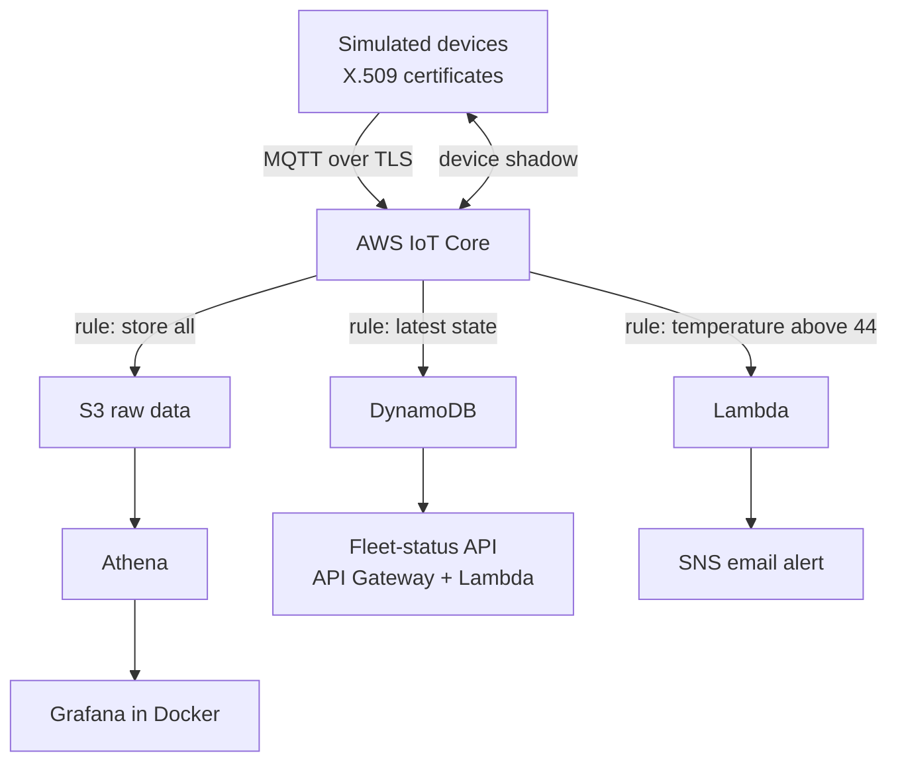

# FleetPulse

A device-to-cloud IoT platform on AWS. Simulated devices stream telemetry over MQTT to AWS IoT Core, where it is stored, queried, visualized, and alerted on. Device settings can be changed remotely, and a small API shows which devices are online.

**Status:** in progress (Days 1-9 of the build are done)

## Architecture

## What works today

- [x] Python device simulator with per-device X.509 certificates (MQTT, mutual TLS)
- [x] One shared IoT policy for all devices, using the thing-name policy variable
- [x] IoT rules storing every message in S3 and DynamoDB
- [x] Athena table, analysis queries and data-quality checks
- [x] Lambda + SNS temperature alerts by email
- [x] Grafana dashboard (running in Docker) with three panels
- [x] Device shadow: change a device's publish interval from the cloud
- [x] Fleet-status API (API Gateway, Lambda, DynamoDB) with a key check
- [x] Offline buffering and automatic reconnect in the simulator
- [x] 11 pytest unit tests

## Planned

- [ ] OTA updates with IoT Jobs
- [ ] Infrastructure as code with Terraform
- [ ] Docker fleet of simulated devices
- [ ] CI/CD with GitHub Actions
- [ ] Stretch: C++ client or Raspberry Pi edge gateway

## Tech

Python, AWS IoT Core, MQTT, Lambda, SNS, S3, DynamoDB, API Gateway, Athena, Grafana, Docker, SQL, pytest

## Run the simulator

You need your own AWS account, a Thing and certificate per device, and the fleet policy attached. Put each device's files in `certs/<device-name>/` (this folder is git-ignored), then:

    pip install awsiotsdk
    export FLEETPULSE_ENDPOINT="<your IoT Core device data endpoint>"
    python3 device/simulator.py fleetpulse-device-001 30

The second argument is the number of messages to send.

## Run the tests

    pip install pytest
    python3 -m pytest

## Security notes

- One certificate per device, so a single device can be revoked without affecting the fleet
- Least-privilege policies: each device can only use its own client ID, topics, and shadow
- The API checks a shared key, which is kept out of the repo
- No certificates, keys, or credentials in this repo (see `.gitignore`)

## Lessons learned

- An IoT policy edit does nothing until the new version is set as **active**
- S3 keys are plain strings: three leading spaces created a different prefix, and Athena returned 0 rows
- A DynamoDB key named device-id did not match device_id in the messages, so the rule silently stored nothing
- Timestream for LiveAnalytics is closed to new customers, so I used Athena and Grafana instead

## Repo layout

    device/            device simulator and telemetry logic
    cloud/lambdas/     alert Lambda and fleet-status API Lambda
    sql/               Athena table, queries and quality checks
    dashboards/        Grafana dashboard JSON
    tests/             pytest unit tests
    docs/              notes for each build day
