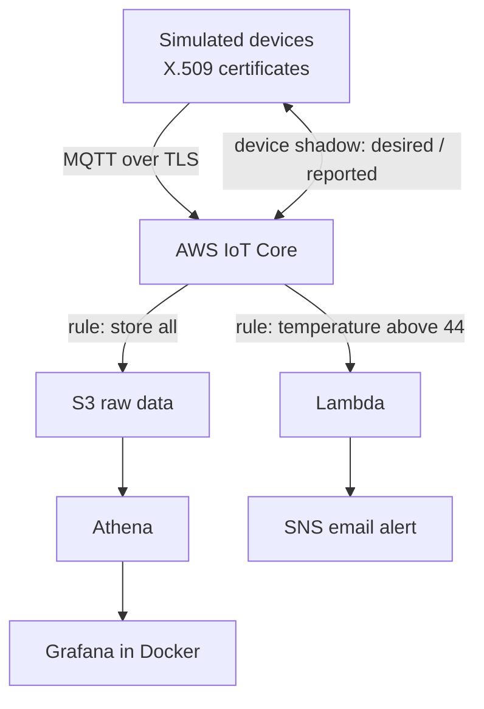

# FleetPulse

A device-to-cloud IoT platform on AWS. Simulated devices stream telemetry over MQTT to AWS IoT Core, where it is stored, queried, visualized, and alerted on. Device settings can be changed remotely.

**Status:** in progress (Days 1-7 of the build are done)

## Architecture

## What works today

- [x] Python device simulator with per-device X.509 certificates (MQTT, mutual TLS)
- [x] One shared IoT policy for all devices, using the thing-name policy variable
- [x] IoT rule storing every message in S3, partitioned by date and device
- [x] Athena table and SQL queries over the raw data
- [x] Lambda + SNS temperature alerts by email
- [x] Grafana dashboard (running in Docker) with three panels
- [x] Device shadow: change a device's publish interval from the cloud

## Planned

- [ ] Fleet-status API (API Gateway, Lambda, DynamoDB)
- [ ] OTA updates with IoT Jobs
- [ ] Infrastructure as code with Terraform
- [ ] Docker fleet of simulated devices
- [ ] CI/CD with GitHub Actions
- [ ] Stretch: C++ client or Raspberry Pi edge gateway

## Tech

Python, AWS IoT Core, MQTT, Lambda, SNS, S3, Athena, Grafana, Docker, SQL

## Run the simulator

You need your own AWS account, a Thing and certificate per device, and the fleet policy attached. Put each device's files in `certs/<device-name>/` (this folder is git-ignored) and set `ENDPOINT` in `device/simulator.py`.

    pip install awsiotsdk
    python3 device/simulator.py fleetpulse-device-001 30

The second argument is the number of messages to send.

## Security notes

- One certificate per device, so a single device can be revoked without affecting the fleet
- Least-privilege policies: each device can only use its own client ID, topic, and shadow
- No certificates, keys, or credentials in this repo (see `.gitignore`)

## Lessons learned

- An IoT policy edit does nothing until the new version is set as **active**
- S3 keys are plain strings: three leading spaces created a different prefix, and Athena returned 0 rows
- Timestream for LiveAnalytics is closed to new customers, so I used Athena and Grafana instead

## Repo layout

    device/            device simulator
    cloud/lambdas/     alert Lambda
    sql/               Athena table and queries
    dashboards/        Grafana dashboard JSON
    docs/              notes for each build day
